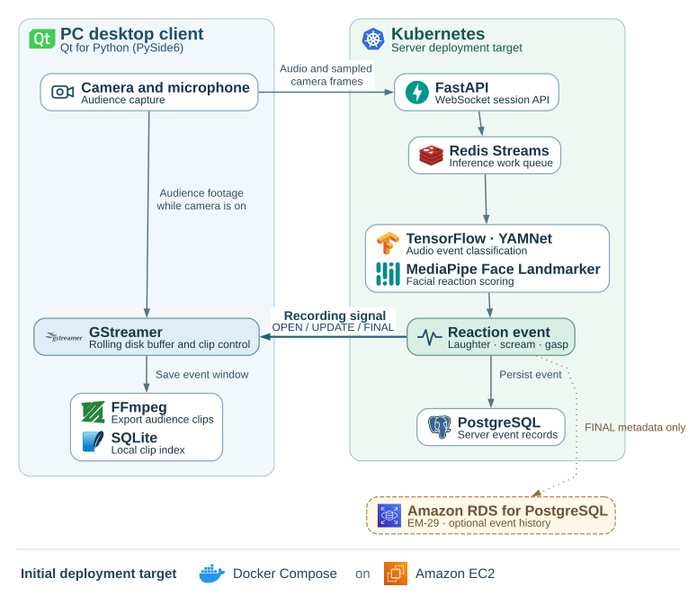

# Encore Moment

CSE406 Software Engineering · Group Encore · Hanyang University

Encore Moment is a PC application designed to capture an audience’s reactions while they watch a video. When a viewer laughs, screams, or gasps, the system saves the moments before and after the reaction as a local clip for review in Tonight’s Highlights.

<p>
  <a href="https://giphy.com/gifs/OnceInHollywood-leonardo-dicaprio-leo-kd9BlRovbPOykLBMqX"></a><br>
  <em>By the time you hit record, the moment’s already over.</em>
</p>

## System architecture



The desktop client uses the viewer’s camera and microphone. The camera starts off. When the viewer enables it, the client keeps recent audience footage in a rolling disk buffer and sends sampled camera frames for analysis. The content player provides an echo-cancellation reference so the server can distinguish audience sounds from the soundtrack. With the camera off, microphone-based detection can still add events to the timeline.

The server combines audio and facial cues and sends a timestamped recording signal back to the PC. **OPEN** protects the available footage starting 15 seconds before the trigger. **UPDATE** extends the window on a repeat detection. **FINAL** schedules local export once the post-event footage is available. The default window ends 10 seconds after the trigger.

The target server has a session API, a Redis work queue, an inference worker, and PostgreSQL event storage. Docker Compose on AWS EC2 is the initial deployment target. The same services must also be deployable on a GPU-capable **Kubernetes** cluster under Requirement 13. The dotted EM-29 path shows optional managed PostgreSQL history on Amazon RDS for finalized event metadata. [Submission B specifications](documents/submission-b/sections/specifications.tex) · [EM-29](https://github.com/SWE-encore/encoremoment/pull/15)

For a demonstration, the Chrome prototype substitutes shared-tab audio and frames for the desktop sensors. The native desktop demo uses fixtures for clip review. [Run the prototype](client/tab-demo/README.md) · [Desktop implementation](docs/architecture.md)

## Quick start

Run commands from the repository root unless noted otherwise. The full player targets **Ubuntu 24.04 / Python 3.12 / PySide6 6.8.3 / GStreamer 1.24**.

```bash
sudo apt update
sudo apt install python3-venv python3-gi gir1.2-gstreamer-1.0 \
  gstreamer1.0-plugins-base gstreamer1.0-plugins-good \
  gstreamer1.0-plugins-bad gstreamer1.0-libav ffmpeg libegl1 libopengl0 libxcb-cursor0
python3 -m venv --system-site-packages .venv
.venv/bin/python -m pip install -r requirements-dev.txt
.venv/bin/python -m pytest -q
cd client
../.venv/bin/python -m encore_client --demo
```

Use **Open video** to open the original content, then click **Start session**.
`--demo` automatically starts a local fake server and replays the duplicate-delivery fixture.
The event table retains one `evt-0004` row; it also appears in Highlights when its phase becomes FINAL.
The Saved clips tab reads a separate sample index. These sample clips are not recordings of the live events.
End preserves the current records. Restart the app to create another session; starting a new session in the same window is future work.

To generate and open a test video, run from the repository root:

```bash
bash client/tools/make_test_video.sh client/samples/test-movie.mp4 30
cd client
../.venv/bin/python -m encore_client samples/test-movie.mp4 --demo
```

Windows supports contract and UI development mode. Validate the full GStreamer player on Ubuntu.

```powershell
python -m venv .venv
.\.venv\Scripts\python -m pip install -r requirements-dev.txt
.\.venv\Scripts\python -m pytest -q
cd client
..\.venv\Scripts\python -m encore_client --demo --no-player
```

To check contract delivery without a window, run `python -m encore_client --demo --headless` from `client/`, using the virtual environment's Python.
To try reaction detection with your microphone or an audio file, run `scripts/encore-bench` (the test bench in [client/README.md](client/README.md)); `scripts/install-bench-shortcut.sh` adds it to the Ubuntu app menu.
Select another fixture with `--scenario ../contracts/samples/05_camera_off.json`.
`--scenario` alone connects to an external fake server; adding `--demo` starts the built-in fake server.
For the session server, start it as described in [server/README.md](server/README.md) and keep the default `--server ws://127.0.0.1:8765` (through an SSH tunnel for a remote host), or use `--server wss://host`. It serves `/v1/sessions/<session_id>/stream`.
In normal mode, Start becomes available after the video's first playback anchor is ready.
Use `--clip-index /path/index.json` to select a saved clip index.
The default is `artifacts/clip_index.json` in normal mode and `samples/clip_index.json` in demo mode.

## Repository layout and responsibilities

```text
contracts/                  Shared PC/server message contract, fixtures, reference receiver, tests
server/
  encore_server/            Session server, YAMNet and optional face/audio fusion
  tests/                    Detector, session, YAMNet, and client-to-server tests
client/
  encore_client/
    __main__.py             Common entry point and demo server lifecycle
    player/                 GStreamer content playback, position, epochs, and anchors
    session/                WebSocket, session state, delivery/deduplication, fake_server
    bench/                  Test bench: built-in server, live model scores, received events
    clips/                  Saved clip index model, list, and local preview
    sensing/                Camera state model; real device adapters are future work
    ui/                     Integrated workspace, Highlights, shared display helpers
  tab-demo/                 Chrome demo entry point and launcher
    sensing/                PCM capture worklet and face-frame selection
    clips/                  Clip intervals, disk buffer, WebM assembly and saved clip lookup
    tests/                  Clip policy, codec and browser playback checks
  tests/                    Native client unit, delivery, UI, and real media tests
  tools/                    Test video generation
  docs/                     Existing EM-23 delivery validation records
samples/                    Synthetic videos and sample index for the clip UI
scripts/                    Sample regeneration, test bench launcher and app-menu shortcut
documents/                  Submission sources, PDFs, and source archives
docs/                       Current architecture, integration decisions and the R1-R11 acceptance record
.github/                    PR template and Ubuntu CI
artifacts/                  Local run outputs, excluded from version control
```

See [architecture.md](docs/architecture.md) for the current data flow and boundaries for future work.
The [R1–R11 acceptance record](docs/em-28-acceptance.md) lists what `main` passes today, with commands, and what is still open by owner.
`server/` is a first session server: sessions in memory, YAMNet in the same process. Its README lists what is not done yet.
`inference/` is a planned component required by the design, **not an implemented service**.
The [EC2 model setup](deploy/models/README.md) installs YAMNet and MediaPipe Face Landmarker
on a shared host for command-line inference testing; it does not run the session server.
This integration does not add empty service skeletons or invent new APIs.

## Current behavior and remaining work

| Component | Current behavior | Remaining work |
|---|---|---|
| Contract | encore.v1 schema, six fixtures, delivery ordering, deduplication, generation handling | Media upload contract and review of draft decisions |
| Content player | Open, play/pause, seek, speed, anchors | Real AEC/sensor pipeline integration and output latency correction |
| Session | WebSocket connection, event delivery, reconnection that resumes after the last result and re-sends controls first, End that waits for open reactions to finish (EM-20), logs | Real server session API, persistence (EM-29) |
| UI | Received event timeline, FINAL events ranked by intensity in Highlights, saved clip review | Event-to-exported-clip links, deletion, new sessions in the same window |
| Sensing state | Camera/microphone capture shown as Off and unavailable; camera state model retained | Device callbacks and control contract integration |
| Clips | Playback offered only for ready/partial entries with a real, nonempty file | EM-2 buffering, FFmpeg generation/verification, SQLite index |
| Server/AI | Session server: control acks, YAMNet reaction events with content timecode, replay from a cursor, in memory. fake_server still replays fixtures | Threshold tuning on real audience audio, Redis/PostgreSQL, session HTTP API and authentication, separate inference workers, deployment |

A `ready` index entry assumes that export has already validated the file. The UI's existence and size checks alone do not guarantee successful decoding.
When the GStreamer echo probe is missing, the player reports it as unavailable. This must not be interpreted as completed AEC support.
The server uses YAMNet, the team's 2026-11-05 decision recorded in the contract README; the design document still names PANNs. The model sits behind a one-function adapter (`server/encore_server/models.py`), so changing it changes no message.

## Team workflow

**Use main as the shared baseline, short-lived feature branches for work, and main as the PR base.**
Do not create a branch for every file edit. A reviewable task can contain multiple commits, with review fixes added to the same branch.
Official documents and READMEs are written in English. Team discussions, PR descriptions, and review comments are written in Korean.

```bash
git switch main
git pull --ff-only origin main
git switch -c feat/EM-number-short-description
# After editing, run tests from the repository root
python -m pytest -q
git add <changed-files>
git commit -m "EM-number: purpose of the change"
git push -u origin feat/EM-number-short-description
# Open a PR on GitHub with base: main
```

- Record the owner, requirement number (R-number), acceptance criteria, and reviewer in the Jira EM ticket/issue. Default to one active implementation task per person.
- Do not append new work to `player/minimal-player` or `em-1/event-contract`. After the integration PR merges, create new branches from the latest main.
- Merge a small prerequisite contract/interface into main first. If dependent PRs are unavoidable, document their bases and merge order, then **explicitly check/change the base to main** after the prerequisite merges.
- If main changes during development, run `git fetch origin`, then `git merge origin/main` on the work branch. Resolve conflicts and rerun tests. Avoid force-pushing shared branches.
- Explain the change, how to run it, test results, and unimplemented features in the PR. Merge after one teammate reviews it and `Client integration` passes. Device/GPU features also require evidence from the corresponding hardware.
- Squash and merge ordinary task PRs, then delete their branches. **For this initial integration PR, use Create a merge commit to preserve the original branch histories.** Delete the old branches only after confirming the integration.
- A repository administrator configures main protection (one reviewer, required CI, restricted force pushes) and automatic branch deletion after merge. This document does not change GitHub settings automatically.
- Add feature code to the relevant package; do not create another standalone app or duplicate Session state. Update the schema, fixture, receiver, and consuming code in the same PR when changing the contract.
- Keep fixtures/fake servers distinct from real features. Passing model tests does not establish that real capture or inference is complete.

The following boundaries follow the roles in the design document; changes require team agreement:

| Owner | Primary scope | Shared review areas |
|---|---|---|
| Soyeon Seol | UI, Highlights, clip review | Session and actual device state display |
| Pavel Kim | Server sessions, records, result stream | contracts and session integration |
| Yujeong Heo | AEC, audio inference, intensity evaluation | Player audio reference and input/result contracts |
| Chul Park | Media buffering, transport, deployment, integration | clips, sensing, common entry point, CI |

The design document does not yet assign facial analysis to an owner. Assign an owner in the ticket before implementation.

## Validation

`python -m pytest -q` collects both the unittest-based contract/session tests and pytest-based clip tests.
Windows may skip eight GStreamer-related tests. Ubuntu CI first checks the real media dependencies, then runs the player tests as well.
GUI tests run offscreen and do not replace validation with real speakers, cameras, or microphones.
Regenerate sample videos with `python scripts/make_samples.py` from the root (FFmpeg required).

## Submission documents

All submission assets are indexed in [documents/](documents/README.md). The published PDFs and ZIPs remain historical copies; current source edits are tracked separately.

## Submission A

The revised proposal and requirements document is preserved separately in IEEE LaTeX format (4 pages). It retains the original smart-TV scope, role table, 22 requirements/objectives, and 27 references; Submission B contains the later PC-first specification.

- [Read the Submission A PDF](documents/encore_moment_submission_a.pdf)
- [Browse the Submission A LaTeX source](documents/submission-a/)
- [Download the Submission A LaTeX package](documents/encore-moment-submission-a-latex.zip)

Build with `cd documents/submission-a` followed by `latexmk -pdf main.tex`. The source README records the original document used for this transcription.

## Submission B

Updated 2026-11-06. The current PDF is 9 pages in IEEE conference format.

- [Read the PDF](documents/encore_moment_submission_b_.pdf)
- [Browse the LaTeX source](documents/submission-b/)
- [Download the complete LaTeX package](documents/encore-moment-submission-b-latex.zip)

The Introduction contains Motivation, User and Client Needs, Related Software, and Team Responsibilities and Roles, including the original role-assignment table adapted to the PC client. Sections II–IV preserve the supplied revised B: Requirements, Development Environment, and Specifications. Requirements 1–11 are Must-Have, and 12–13 are Good-to-Have.

## Build the document

With a LaTeX distribution and `latexmk` installed:

```sh
cd documents/submission-b
latexmk -pdf main.tex
```

Alternatively, upload the complete ZIP to Overleaf and select `submission-b/main.tex` as the main document. The package includes the IEEEtran class/style, bibliography, and all three PDF figures/tables.

GitHub publication is separate from the course LMS submission and printed copy.
