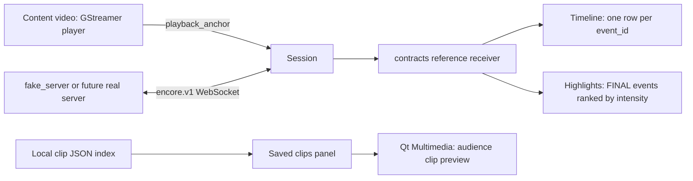

# Integrated architecture and decisions

## Sources and scope

- Submission A preserves the earlier smart-TV scope; Submission B defines the current PC-first design.
- The integration follows the [environment and responsibilities](../submission-b/sections/environment.tex), [R1–R13 requirements](../submission-b/sections/requirements.tex), and [detailed specifications](../submission-b/sections/specifications.tex).
- The contract README remains a draft with unresolved decisions. Planned behavior in a design document is not evidence that the implementation is complete.
- This work combines PR #1 (contract), #2 (player), #3 (session), and the clip UI branch into one application. It does not implement a new server or AI service.

## Data flow

GStreamer continues to play the original content so that its AEC reference and time mapping remain intact.
Qt Multimedia previews audience clips. Starting a clip pauses the original video, and clip playback times are never sent as anchors for the original content.
PySide6-Essentials does not include QtMultimedia, so the common dependency is PySide6 6.8.3.

Session and the contract reference receiver own connection and event state. The UI displays that state instead of inventing connected or camera-on states with timers.
The clip and camera state models remain testable without Qt. The camera model is not yet connected to real hardware.
The current UI does not start sensing devices. Demo sensor control messages reproduce fixtures; they do not operate devices.

## Integration points for future features

| Feature | Integration point and requirements |
|---|---|
| Camera/microphone | Add real adapters in sensing/. Update state through device callbacks and follow the generation rules in contracts |
| AEC | Add microphone DSP to the same top-level pipeline in player/pipeline.py. Distinguish a missing probe from active processing |
| Clip generation | Add buffering/export layers in clips/. Consume FINAL events and contract clip windows; verify decoding before updating the index |
| Clip associations | Explicitly associate session_id/event_id with clip_id. Do not arbitrarily match the current sample list to live events |
| SQLite | Replace the load_index boundary in clips/model.py with a repository interface, retaining UI sorting/display |
| Real server | Preserve the Transport boundary in session/. Agree on the stream path, Start/End, authentication, and media upload contract first |
| Reconnection | Implement EM-20 using the existing Session unsent/cursor state. Do not display a dropped connection as automatically recovered |
| Server/AI/deployment | Add server/, inference/, and deploy/ in later PRs. The design separates API/worker services and uses Redis/PostgreSQL |

## Existing entry points

The common entry point is `python -m encore_client`. Both `client/ui_main.py` and `python -m encore_client.session` also launch the common application.
`python -m encore_client.player` remains available for media-layer diagnostics.
Run the application from a repository checkout. It directly loads the reference implementation in contracts and is not currently a distributable pip wheel package.

## Merge history

The integration started from main at `7607361`.
Original refs: `em-1/event-contract`=`c369123`, `player/minimal-player`=`cc3249b`,
`feature/sprint1-clip-list-status`=`a74184c`.
The three refs are merged into an integration branch based on main, followed by the common entry point and structure changes.
Use a merge commit for this PR to preserve the original work; squash merging is recommended for subsequent single-task PRs.
