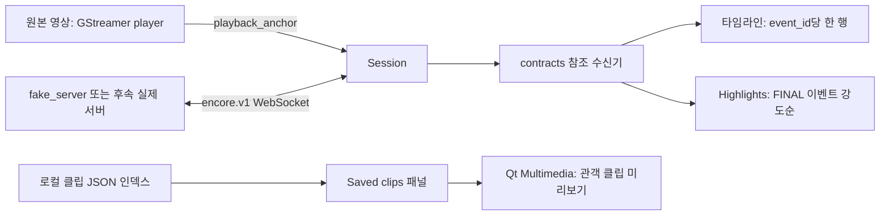

# 통합 구조와 결정

## 근거와 범위

- Submission A는 과거 smart-TV 범위, Submission B는 현 PC-first 설계입니다.
- [환경·담당 역할](../submission-b/sections/environment.tex), [R1–R13](../submission-b/sections/requirements.tex), [상세 명세](../submission-b/sections/specifications.tex)를 기준으로 기존 구현을 연결했습니다.
- 계약 README는 draft이며, 미해결 결정은 유지합니다. 설계에 적힌 미래 동작은 구현 완료 증거가 아닙니다.
- 이전 PR #1(계약), #2(플레이어), #3(세션)와 클립 UI 브랜치의 작업을 공통 앱으로 통합합니다. 신규 서버/AI를 만드는 작업은 포함하지 않습니다.

## 데이터 흐름

원본 영상은 계속 GStreamer가 담당합니다. AEC 참조와 시간 매핑을 위해 다른 재생기로 바꾸지 않습니다.
관객 클립은 Qt Multimedia로 미리봅니다. 클립을 재생하면 원본 영상을 일시정지하고, 클립 재생 시각을 원본 영상 anchor로 보내지 않습니다.
PySide6-Essentials만으로는 QtMultimedia가 없으므로 공통 의존성을 PySide6 6.8.3으로 통일했습니다.

Session과 계약 참조 수신기가 연결·이벤트 상태를 소유합니다. UI는 상태를 표시하며 임의의 타이머로 connected나 camera-on을 만들어내지 않습니다.
클립 모델과 카메라 상태 모델은 Qt 없이 테스트할 수 있도록 보존했습니다. 카메라 모델은 실제 장치와 아직 연결되지 않았습니다.
현재 UI는 감지 장치를 시작하지 않습니다. 데모의 sensor control 메시지는 샘플 재현이며 장치 동작이 아닙니다.

## 후속 기능의 연결 지점

| 기능 | 연결 위치와 조건 |
|---|---|
| 카메라/마이크 | sensing/에 실제 어댑터 추가. device callback으로 상태 변경, 세대 규칙은 contracts와 일치시킬 것 |
| AEC | player/pipeline.py의 동일 top-level 파이프라인에 마이크 DSP 연결. probe 미설치와 실제 활성 상태 구분 |
| 클립 생성 | clips/에 버퍼·export 계층 추가. FINAL 이벤트/계약 clip window 소비, 디코딩 검증 후 인덱스에 반영 |
| 클립 연결 | session_id/event_id와 clip_id를 명시적으로 연결. 현재 샘플 목록을 실시간 이벤트와 임의 매칭하지 않음 |
| SQLite | clips/model.py의 load_index 경계를 repository 인터페이스로 교체. UI 정렬/표시는 유지 |
| 실제 서버 | session/의 Transport 경계 유지. 스트림 경로, Start/End, auth, 미디어 업로드 계약을 먼저 합의 |
| 재연결 | 기존 Session의 unsent/cursor 기반으로 EM-20 구현. 단절을 자동 회복한 것처럼 표시하지 않음 |
| 서버·AI·배포 | 후속 PR에서 server/, inference/, deploy/ 추가. 설계상 API/worker 분리, Redis/PostgreSQL 사용 |

## 기존 진입점

공통 진입점은 `python -m encore_client`입니다. `client/ui_main.py`와 `python -m encore_client.session`도 공통 앱으로 연결합니다.
`python -m encore_client.player`는 미디어 계층 진단용으로 유지합니다.
공통 앱은 repo checkout에서 실행합니다. contracts의 참조 구현을 직접 읽으므로 현재 pip wheel 배포 패키지는 아닙니다.

## 병합 이력

통합 시작 기준 main: `7607361`.
원본 refs: `em-1/event-contract`=`c369123`, `player/minimal-player`=`cc3249b`,
`feature/sprint1-clip-list-status`=`a74184c`.
세 ref를 main 기반 통합 브랜치에 병합한 뒤 공통 실행/구조 변경을 추가합니다.
원본 작업을 보존하기 위해 이번 PR은 merge commit 방식으로 합치고, 이후 단일 작업 PR은 squash 방식으로 운용하는 것을 권장합니다.
